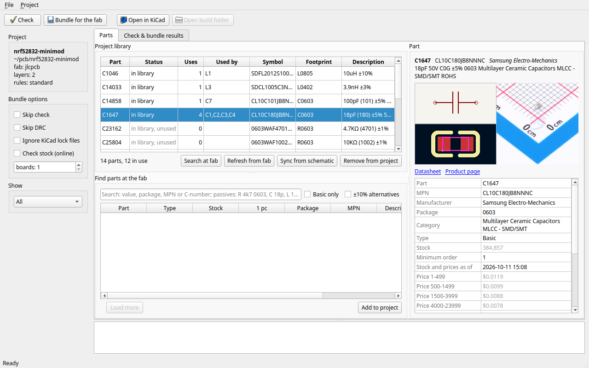

# kifab

Manage KiCad projects in a git-friendly way, with the fabrication service as a
first-class part of the project.

KiCad stays the editor. kifab takes care of everything around it:

- **Fab libraries, vendored into the project.** Symbols, footprints and 3D
  models of the parts you use live in `lib/`, so the project builds the same on
  any machine and in CI.
- **The fab's design rules, enforced by KiCad's own DRC.** kifab writes them into
  the project and warns when Board Setup allows less than the fab can make.
- **One command to order.** `kifab bundle` checks the project, runs DRC and
  writes the gerbers, BOM and placement files the fab expects.
- **Git hygiene.** Generated files are deterministic (same commit, same bytes),
  and `kifab check` flags what should not be tracked.

## Install

    uv tool install kifab        # or: pip install kifab

With the graphical interface: `pip install 'kifab[gui]'`.

`kifab bundle` needs `kicad-cli` (KiCad 10) on `PATH`, or `KIFAB_KICAD_CLI` set
to the command to run.

Linux: system libraries for the GUI

Qt's X11 support needs libraries pip cannot install. On Wayland sessions they are
not needed; `kifab-gui` then uses Qt's Wayland support and says what is missing
if neither works.

    sudo apt install libxcb-cursor0 libxcb-icccm4 libxcb-keysyms1 libxcb-shape0 \
        libxcb-render-util0 libxcb-image0 libxcb-randr0 libxcb-xkb1 libxkbcommon-x11-0

## The GUI

    kifab-gui [PROJECT]

The Parts tab lists the project's library: each part's symbol and footprint, and
where it is used. Search the fab's catalogue as you type (`R 4k7 0603`,
`C 18p`), see stock, price and Basic/Extended class, and add a part to the
project with one click. **Check** and **Bundle for the fab** run with live
progress, and **Open in KiCad** is a click away.

## Using the CLI

**Start a project that follows the fab's rules.**

    kifab init my_project jlcpcb

**Find a part and vendor it.** No hunting for libraries; the part's symbol,
footprint and 3D model are fetched into `lib/`.

    kifab component search R 4k7 0603 --basic --add

**Keep the library in step with the schematic.** After placing parts in KiCad,
vendor everything the schematic uses.

    kifab component sync

**Check before you order.** Works offline on any KiCad project and returns
non-zero on errors, so it fits CI.

    kifab check

**Produce the order files.**

    kifab bundle

**Release from a git tag.** A workflow that attaches the bundle to a GitHub
release.

    kifab ci init

## Commands

| Command | What it does |
| --- | --- |
| `kifab init <name> <fab>` | New project (`--layers N`, `--no-git`) |
| `kifab rules apply` | Write the fab's design rules into the project |
| `kifab check` | Is it self-contained? Rules respected? Git clean? (`--json`, `--strict`) |
| `kifab bundle` | Gerbers, BOM, placement and report into `build/` (`--skip-drc`, `--json`) |
| `kifab ci init` | GitHub workflow that builds a release on `v*` tags |
| `kifab order record` | Archive what you ordered in `orders/` |
| `kifab component search TEXT` | Search the supplier's catalogue (`--basic`, `--sort stock\|price`, `--add`) |
| `kifab component add ID...` | Vendor parts by supplier number or MPN |
| `kifab component sync` | Vendor every part the schematic uses |
| `kifab component list` | What is vendored, and where it is used |
| `kifab component remove ID...` | Drop parts and the files only they use |
| `kifab component check` | Stock, class and price for the project's parts |
| `kifab kicad-plugin install` | Optional KiCad toolbar button that opens the GUI on the open project |
| `kifab-gui` | The graphical interface |

Examples:

    kifab component search R 4k7 0603 -a      # passives by value; -a adds E24 values within ±10%
    kifab component add C123456               # by supplier number
    kifab component check --boards 10         # stock for ten boards
    kifab bundle --json                       # machine-readable result
    kifab check --strict                      # warnings fail too

Most commands take the project directory as an optional last argument and
default to the current one. Exit codes: 0 ok, 1 errors, 2 bad input.

Details, configuration and file formats are in
[docs/reference.md](docs/reference.md).

## Compatibility

Fabs, suppliers and library sources are plugins.

> **Verify before you order.** kifab's design rules, catalogue data, stock,
> prices, vendored libraries and generated manufacturing files come from
> third-party sources and from interpretations of them. They may be wrong,
> incomplete or out of date. It is your responsibility to review the result,
> for example in the fab's own file viewer and checks, before ordering. No
> guarantee of correctness can be made.

| Fab | Design rules | Order files |
| --- | --- | --- |
| JLCPCB | `standard` | Gerbers, BOM and placement for assembly |
| AISLER | `hasl`, `enig` | One zip for upload, plus BOM and placement for reading |

| Supplier (catalogue, stock, price) |
| --- |
| JLCPCB parts library |
| LCSC |

| Library source (symbols, footprints, 3D) |
| --- |
| EasyEDA |

| Integration | |
| --- | --- |
| KiCad 10 | `kicad-cli` for DRC and plots; optional toolbar plugin |
| git | `.gitignore` block, deterministic output, `kifab check` hygiene rules |
| GitHub Actions | Release workflow from `kifab ci init` |

## Development

    uv sync
    scripts/check.sh          # black --check, mypy --strict, pytest

The tests need neither KiCad nor network; see
[docs/development.md](docs/development.md).

## License

kifab is free software: you can redistribute it and/or modify it under the
terms of the GNU General Public License, version 3 only, as published by the
Free Software Foundation. See [LICENSE](LICENSE). It comes with no warranty.

kifab's S-expression formatter is ported from KiCad (GPL-3.0-or-later, used
under version 3). easyeda2kicad (AGPL-3.0) is run as a separate program;
PySide6 (LGPL-3.0) is used for the GUI.
